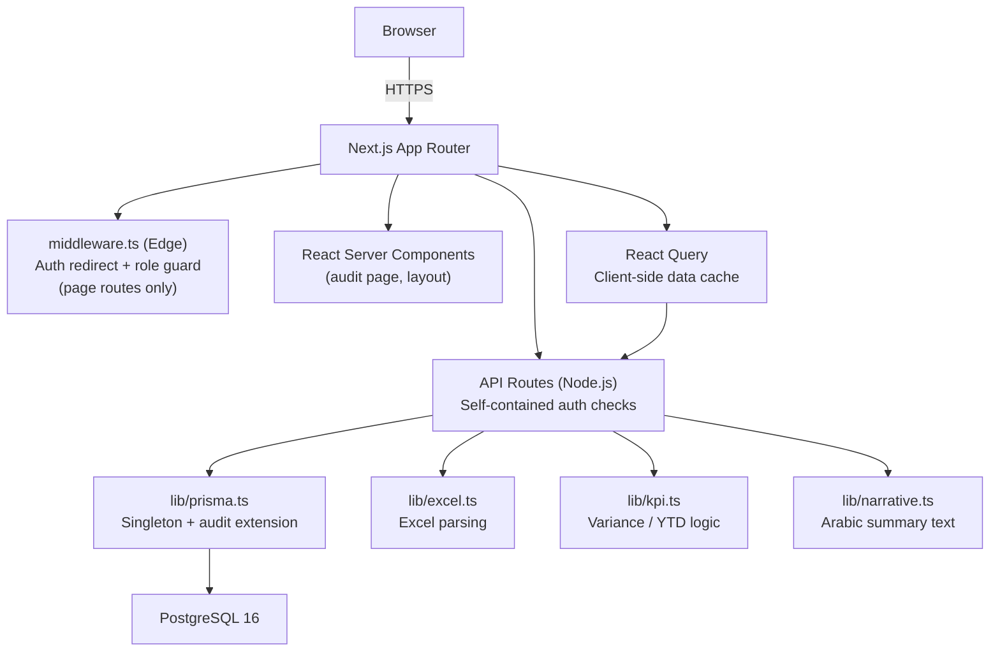

# Engineering Review — Cultural Dashboard (ERS)

**Date:** 2026-11-05  
**Reviewer:** Principal Engineering Audit  
**Scope:** Read-only audit. Only this file was created.

---

## 1. Executive Summary

The ERS codebase is a well-structured Next.js 16 application with solid foundations: Prisma with PostgreSQL, NextAuth v5 JWT sessions, bcrypt password hashing (cost 12), server-side role checks on every mutating API route, and a meaningful automated-test suite for the core business logic. The RTL-first layout, Arabic narrative generation, and Excel ingestion pipeline are genuinely useful domain work.

**Production readiness verdict: Conditional.** The app can be safely deployed for a small trusted internal audience today with the security and correctness issues below addressed first. It is not ready for external or high-stakes use until the three critical findings are resolved.

**Strongest parts:**
- Server-side authorization is consistent across all API routes; no route relies solely on the middleware.
- The KPI variance logic, YTD computation, and Excel parsing all have good unit test coverage.
- The audit-log middleware is a thoughtful design decision, even though it currently records `userId: 'system'` instead of the real actor (see F-003).
- TypeScript is clean — `npx tsc --noEmit` passes with zero errors.
- Docker Compose gives every developer a reproducible local database.

**Most consequential risks:**
1. **(F-001) No file size or MIME-type validation on upload** — a user with EDITOR or ADMIN access can upload arbitrarily large files, causing memory exhaustion or slow denial-of-service.
2. **(F-002) EDITOR can clear the entire database** — the `/api/admin/clear-data` route allows EDITOR role; this is a data-destructive operation that should be restricted to ADMIN only.
3. **(F-003) Audit log records `userId: 'system'` on every write** — the audit trail is therefore useless for attribution; every action looks like a system event.

**First decision for the owner:** Fix F-001, F-002, and F-003 before onboarding real editors or uploading production KPI data.

---

## 2. Current Architecture and Behavior

### Stack

| Layer | Technology |
|---|---|
| Framework | Next.js 16.2.4 (App Router) |
| Language | TypeScript 5 |
| Styling | Tailwind CSS v4 + custom CSS variables |
| Components | Shadcn/UI (Base UI primitives) + Lucide icons |
| Auth | NextAuth v5 (beta.31) — Credentials provider, JWT strategy |
| ORM | Prisma v7 with `@prisma/adapter-pg` (pg pool) |
| Database | PostgreSQL 16 (Docker) |
| Charts | Recharts v3 |
| PDF | @react-pdf/renderer v4 (server-side, Cairo font embed) |
| Excel | xlsx v0.18.5 |
| Testing | Jest 30 + Testing Library |
| State | React Query v5 (client fetch cache) |

### Component boundaries



### Critical user journeys

| Journey | Entry | Auth check |
|---|---|---|
| Login | `POST /api/auth/callback/credentials` | bcrypt verify → JWT |
| View dashboard KPIs | `GET /api/kpis` | Middleware redirect (unauthenticated) |
| Upload Excel | `POST /api/upload` | Server: session role ≠ VIEWER |
| Drill-down on KPI | `GET /api/kpis/:id` | None (unauthenticated access possible — see F-005) |
| Export PDF | `GET /api/export/pdf` | None (unauthenticated access possible — see F-005) |
| Admin: manage users | `GET/POST /api/admin/users` | Server: role === ADMIN |
| Admin: audit log | `/admin/audit` (RSC) | Middleware redirect |
| Clear data | `POST /api/admin/clear-data` | Server: role === ADMIN **or EDITOR** (bug — see F-002) |

### Data flow: upload pipeline

```
Browser FileUploader → POST /api/upload (FormData)
  → parseActivityFile / parseExcelFile (lib/excel.ts)
  → dry-run preview (returned to browser)
  → user confirms → POST again with dryRun=false
  → prisma.$transaction (upsert KPIs, Targets, Actuals)
  → audit log via Prisma extension (userId: 'system' — bug)
```

---

## 3. Audit Coverage and Baseline

### What was inspected

- All 20 API routes (full source)
- Authentication and authorization chain: middleware.ts, auth.config.ts, auth.ts
- Prisma schema, all 2 migrations, seed files
- Core libraries: lib/kpi.ts, lib/excel.ts, lib/narrative.ts, lib/prisma.ts, lib/auth-utils.ts
- All test files (6 test suites)
- Key components: DashboardContent, FileUploader, DrillDownModal, Sidebar, UserPanel
- Configuration: next.config.ts, docker-compose.yml, package.json, .gitignore, tsconfig.json

### Checks run

| Check | Result |
|---|---|
| `npx tsc --noEmit` | **PASS** — 0 errors |
| `npm run lint` | **FAIL** — 38 errors, 17 warnings (see F-008) |
| `npm test` | **FAIL** — 8 tests fail across 5 suites (see F-007) |
| `.env` in git | PASS — `.gitignore` excludes `.env` and `.env*.local` |

### What could not be verified

- **Live database connectivity** — no DATABASE_URL was available during the audit. Claims about Prisma query correctness are based on static code analysis.
- **TLS certificate validation in production** — `ssl: { rejectUnauthorized: false }` is set unconditionally in `lib/prisma.ts`; this silences TLS errors in all environments including production.
- **Build output size** — `npm run build` was not run to avoid side effects; bundle size estimates are code-level observations.
- **Actual audit log behavior with a live DB** — the `userId: 'system'` bug is verified by static inspection.

---

## 4. Findings

### Severity legend
- **CRITICAL** — Data loss, unauthorized data access, or denial of service with low preconditions
- **HIGH** — Material security or reliability issue requiring a code change before production
- **MEDIUM** — Correctness, maintainability, or operational issue affecting real use
- **LOW** — Code quality, test coverage, or cosmetic issue

---

### F-001 · CRITICAL · No file size or MIME-type validation on upload

**Affected route:** `POST /api/upload` (`app/api/upload/route.ts`)

**Evidence:** The route reads the full file body into memory via `file.arrayBuffer()` with no preceding size check. The `accept=".xlsx,.xls,.csv"` attribute on the `<input>` element is a client-side hint that any HTTP client ignores. `maxDuration = 60` limits the request duration but not the payload size.

**Impact:** Any EDITOR or ADMIN can send a multi-hundred-megabyte or malformed binary to the server. `xlsx` is known to be memory-intensive parsing large files. A single upload can exhaust the Node.js heap and crash the Next.js process, taking the dashboard offline for all users.

**Confidence:** Verified by source inspection. No server-side guard of any kind exists for file size or type.

**Recommended change:**
```typescript
// At the top of the POST handler, after reading the File object
const MAX_BYTES = 10 * 1024 * 1024 // 10 MB
if (file.size > MAX_BYTES) {
  return NextResponse.json({ error: 'حجم الملف يتجاوز الحد المسموح به (10 ميجابايت)' }, { status: 413 })
}
const ALLOWED_TYPES = new Set([
  'application/vnd.openxmlformats-officedocument.spreadsheetml.sheet',
  'application/vnd.ms-excel',
  'text/csv',
])
if (!ALLOWED_TYPES.has(file.type)) {
  return NextResponse.json({ error: 'نوع الملف غير مدعوم' }, { status: 415 })
}
```

**Verification:** Upload a 50 MB binary via curl; confirm 413 is returned before `arrayBuffer()` is called.

---

### F-002 · CRITICAL · EDITOR can delete all KPI data

**Affected route:** `POST /api/admin/clear-data` (`app/api/admin/clear-data/route.ts`, line 9)

**Evidence:**
```typescript
if (!session || (session.user.role !== 'ADMIN' && session.user.role !== 'EDITOR')) {
```
This condition allows EDITOR to call the route. The route executes `deleteMany()` on Actuals, Targets, and KpiRegistry — wiping the entire reporting dataset in one transaction.

**Impact:** Any EDITOR can destroy all production KPI data with a single authenticated POST. There is no confirmation or recovery mechanism in the API layer. Backups exist only if the operator has set up PostgreSQL dumps independently of this application.

**Confidence:** Verified by direct source inspection.

**Recommended change:** Change the authorization check to `role !== 'ADMIN'` only, mirroring the intent of the RBAC matrix (ADMIN = full config).

**Existing behavior change:** EDITORs currently see the "مسح جميع البيانات" button in `FileUploader.tsx` only if `isAdmin` is true (checked client-side from session). That check already restricts the UI correctly, but the API does not enforce it. Fixing the API brings the server-side rule into alignment with the UI intent — no user-visible behavior change for correctly behaving clients.

**Verification:** Log in as an EDITOR account and POST to `/api/admin/clear-data`; confirm 403 is returned.

---

### F-003 · HIGH · Audit log records `userId: 'system'` instead of the actual actor

**Affected file:** `lib/prisma.ts`, line 43

**Evidence:**
```typescript
await (base as any).auditLog.create({
  data: {
    userId: 'system',  // ← hardcoded
    ...
  },
})
```

The Prisma extension intercepts writes to `KpiRegistry` and `Actual` models but has no access to the HTTP request context, so it cannot know which user triggered the write.

**Impact:** The audit log page (`/admin/audit`) is misleading — every row shows "system" as the actor, making it useless for accountability or incident investigation. This violates the RBAC contract described in CLAUDE.md ("Every data mutation writes to an AuditLog table with userId").

**Confidence:** Verified by source inspection. The `audit` page at `app/admin/audit/page.tsx` renders `log.userId` directly.

**Recommended change:** Remove the cross-cutting audit extension from `lib/prisma.ts`. Instead, write audit log entries explicitly within each API route handler where the session is available:

```typescript
// In upload/route.ts, after a successful upsert:
await prisma.auditLog.create({
  data: {
    userId: session.user.id,
    action: `KpiRegistry.upsert`,
    kpiId: kpi.id,
    newValue: JSON.stringify({ nameAr: kpi.nameAr, pillar: kpi.pillar }),
  },
})
```

This is more code but produces a correct, attributable audit trail. The `auditLog` model should not be in `AUDITED_MODELS` after this change.

**Migration impact:** Existing audit log rows with `userId: 'system'` will remain in the database. No schema change is required.

**Verification:** Upload a file as an EDITOR; confirm the audit log shows the editor's real user ID.

---

### F-004 · HIGH · Unauthenticated access to KPI detail and PDF export endpoints

**Affected routes:**
- `GET /api/kpis/:id` (`app/api/kpis/[id]/route.ts`) — no auth check
- `GET /api/export/pdf` (`app/api/export/pdf/route.ts`) — no auth check

**Evidence:** Both route files call `prisma` queries but never call `auth()` or check a session. The middleware in `middleware.ts` deliberately excludes all `/api/` routes:

```typescript
matcher: ['/((?!_next/static|_next/image|favicon.ico|dabs-logo.png|api/).*)',]
```

**Impact:** Any unauthenticated HTTP client can fetch individual KPI drill-down data and generate a full PDF report with all KPI names, actual values, targets, and narrative text. For an internal executive reporting system handling sensitive performance data, this is a material information-disclosure risk.

**Confidence:** Verified by source inspection. The pattern holds for both routes.

**Recommended change:** Add an auth guard at the top of each handler:
```typescript
const session = await auth()
if (!session) return NextResponse.json({ error: 'غير مصرح' }, { status: 401 })
```

**Verification:** `curl http://localhost:3000/api/export/pdf` without a session cookie — confirm 401 before the fix, then confirm PDF generation is blocked without a cookie after.

---

### F-005 · HIGH · `rejectUnauthorized: false` unconditionally disables TLS certificate validation

**Affected file:** `lib/prisma.ts`, line 11

**Evidence:**
```typescript
const pool = new Pool({ connectionString: url, ssl: { rejectUnauthorized: false } })
```

**Impact:** In a production environment where the PostgreSQL server uses a self-signed certificate (common in cloud managed DB offerings), this silences the TLS handshake error and connects anyway — but it also silences errors from a genuinely invalid or forged certificate. A man-in-the-middle attacker on the same network segment could intercept all database traffic.

**Confidence:** Verified by source inspection. The flag is not conditioned on `NODE_ENV`.

**Recommended change:**
```typescript
const ssl = process.env.DATABASE_SSL_REJECT_UNAUTHORIZED === 'false'
  ? { rejectUnauthorized: false }
  : { rejectUnauthorized: true }
const pool = new Pool({ connectionString: url, ssl })
```
Set `DATABASE_SSL_REJECT_UNAUTHORIZED=false` only in local dev `.env` files. Production `.env` should omit this variable or set it to `true`.

**Verification:** Confirm the Docker local setup still connects with the new env var set to `false` in `.env`. Confirm that a production connection attempt to a server with an invalid certificate is now rejected.

---

### F-006 · HIGH · Conditional React hook call in DepartmentDashboard

**Affected file:** `components/department/DepartmentDashboard.tsx`, line 79-82

**Evidence:**
```typescript
export function DepartmentDashboard({ pillarId }: Props) {
  const config = DEPT_DASHBOARDS[pillarId]
  if (!config) return null          // ← early return before useQuery
  const { nameAr, icon, color, data: staticData } = config

  const { data: dbData, isLoading } = useQuery<DeptData | null>({  // ← line 82
```

ESLint flags this as `react-hooks/rules-of-hooks` error. The `useQuery` call on line 82 follows a conditional `return null` on line 79. If `config` is ever undefined at runtime, React will see a different number of hooks rendered than it expects, causing an unrecoverable component error.

**Impact:** In practice `DEPT_DASHBOARDS` covers all 13 pillars in `PillarId`, so this path currently does not trigger. But it is a latent bug: any navigation to an unmapped pillar will produce a React invariant violation crash instead of a graceful empty state.

**Confidence:** Verified by ESLint output and source inspection.

**Recommended change:** Move the config lookup after all hooks, or refactor the early return into a conditional render within the hook-safe body:
```typescript
export function DepartmentDashboard({ pillarId }: Props) {
  const config = DEPT_DASHBOARDS[pillarId]
  const { data: dbData, isLoading } = useQuery<DeptData | null>({
    queryKey: ['dept', pillarId],
    queryFn: () => fetch(`/api/departments/${pillarId}`).then(r => r.json()),
    enabled: !!config,
  })
  if (!config) return null
  // ...rest
}
```

**Verification:** TypeScript and ESLint both pass; `useQuery` is not conditionally called.

---

### F-007 · MEDIUM · 8 failing tests across 5 suites

**Affected files:** Multiple test files

**Evidence:**
```
Tests:  8 failed, 66 passed, 74 total
Test Suites: 5 failed, 6 passed, 11 total
```

Specific failures (confirmed by running `npm test`):

1. **`lib/narrative.test.ts` (3 failures):** Tests assert `generateNarrative` includes individual KPI names like `'توزيع المصاحف'` in its output. The actual `generateNarrative` function produces aggregate summary sentences (counts only), not per-KPI mentions. The tests describe an API that never existed — either the tests are wrong (they describe an aspirational behavior) or the implementation was simplified without updating the tests. Currently the tests are the lie.

2. **`components/layout/Sidebar.test.tsx` (4 failures):** Tests expect the app name `'قطاع الثقافة'` to appear in the sidebar. The sidebar renders a division-dependent label from `DIVISION_MAP` (e.g., `'الثقافة والبحوث'`), not a hardcoded string. Test fixtures do not mock `useSearchParams`.

3. **`prisma/seed.test.ts` (1 failure):** Integration test asserts that all KPIs belong to 7 known departments. The schema now has 13 pillars (institutional support and zakat departments were added), but the test's allowlist was not updated. This test connects to a real database — it failing in CI is dangerous because it may mask actual schema drift.

**Impact:** A failing test suite gives no confidence signal to developers. The seed test connecting to a live database without a test database guard is a risk in CI environments.

**Recommended change:**
- Update `lib/narrative.test.ts` to match the actual function contract (count-based, not KPI-name-based).
- Update `Sidebar.test.tsx` to mock `useSearchParams` and query the correct rendered string.
- Update `prisma/seed.test.ts` valid-pillars set to include all 13 current pillars, and add a guard that skips the test if `DATABASE_URL` is not set (to prevent it from running against production).

---

### F-008 · MEDIUM · 38 ESLint errors (lint gate is broken)

**Affected:** Multiple files throughout the codebase

**Evidence:** `npm run lint` reports 38 errors. Key categories:

- **`@typescript-eslint/no-explicit-any`** — Widespread use of `as any` casts in `auth.ts`, `auth.config.ts`, `lib/prisma.ts`, `components/department/CommentThread.tsx`, `components/kpi/DeptOverview.tsx`. These casts suppress type errors that may hide real bugs.
- **`react-hooks/rules-of-hooks`** — The DepartmentDashboard conditional hook issue (F-006).
- **`react/no-unescaped-entities`** — Minor rendering correctness issue in `app/demo/colors/page.tsx`.

**Impact:** A broken lint gate means new errors accumulate silently. The `any` casts in auth callbacks are particularly risky because they propagate unvalidated data from the JWT into the session object without a compile-time check.

**Recommended change:** Fix `auth.ts` and `auth.config.ts` by declaring proper types using NextAuth's declaration merging (the `types/next-auth.d.ts` module augmentation already exists and should be used instead of `as any` casts). Fix the `lib/prisma.ts` extension by typing the intercepted args correctly using Prisma's internal types.

---

### F-009 · MEDIUM · Audit log routes and PDF export fetch all KPIs without pagination

**Affected routes:**
- `GET /api/export/pdf` — `findMany` with no `take` limit
- `GET /api/departments/:pillar` — `findMany` on KPIs with two years of actuals
- `GET /api/kpis` — `findMany` with no `take` limit
- `/admin/audit` (RSC) — `findMany` with `take: 200` (bounded, acceptable)

**Evidence:** `app/api/export/pdf/route.ts` line 35: `findMany` with no row limit. At scale (hundreds of KPIs per department × quarterly actuals), a single PDF export request issues a large unindexed query.

**Impact:** Currently not a performance problem given the small expected dataset. If 500+ KPIs are uploaded, the PDF and stats endpoints will degrade noticeably. The `Actual` table has a composite unique index on `[kpiId, period, year]` but no index on `kpiId` alone for the common lookup pattern.

**Recommended change:** Add `take` limits to all unbounded `findMany` calls that render to users. Add a Prisma index on `Actual(kpiId)` and `Target(kpiId)` to speed up the per-KPI includes:
```prisma
model Actual {
  @@index([kpiId])
}
model Target {
  @@index([kpiId])
}
```

---

### F-010 · MEDIUM · Hard-coded reporting year 2026 appears in 8+ places

**Affected files:** `lib/excel.ts` (QUARTER_COL map), `app/api/upload/route.ts` (year 2026 literals), `app/api/kpis/route.ts` (default year), `data/departments/*.ts` (all static data files), `app/api/departments/[pillar]/route.ts` (year literals)

**Evidence:** `lib/excel.ts` comment at line 83: "Quarter column names are hardcoded to 2026. To support a different reporting year, update these keys to match the column headers."

**Impact:** Transitioning to 2027 reporting requires finding and updating 8+ locations, with high risk of partial updates causing data mismatches. The `app/api/kpis/route.ts` default year of 2026 is acceptable for now but will silently serve stale data after year rollover.

**Recommended change:** Introduce a single `CURRENT_REPORTING_YEAR` constant (e.g., in `lib/config.ts`) and reference it from all call sites. The Excel parser's `QUARTER_COL` map should derive its keys from this constant.

---

### F-011 · MEDIUM · `VALID_PILLAR_IDS` defined in two places with different values

**Affected files:**
- `lib/departments.ts` line 25 — derived from `DEPARTMENTS` array (13 entries)
- `app/api/comments/route.ts` lines 11-20 — hardcoded set of 8 entries (CULTURE_RESEARCH pillars only)

**Evidence:** The comments API accepts `pillarId` values only for the 8 original departments, silently rejecting comments for the 5 newer departments (HR_MANAGEMENT, ADMIN_AFFAIRS, PROCUREMENT, DEVELOPMENT_PROJECTS, ZAKAT_MANAGEMENT). No error visible to the user.

**Impact:** Comments cannot be posted for any INSTITUTIONAL_SUPPORT or ZAKAT_DEVELOPMENT department. This is a silent functional regression — the UI renders a comment thread but posts will fail with "قسم غير صالح".

**Recommended change:** Replace the inline `VALID_PILLAR_IDS` in `app/api/comments/route.ts` with an import from `lib/departments`:
```typescript
import { VALID_PILLAR_IDS } from '@/lib/departments'
```

---

### F-012 · LOW · Password minimum length is 6 characters

**Affected files:** `app/api/user/change-password/route.ts` line 13, `components/admin/UserPanel.tsx` line 209

**Evidence:** Server validates `newPassword.length < 6`; the UI `minLength={6}` matches.

**Impact:** 6-character minimum is below modern baselines (NIST SP 800-63B recommends 8+, ideally 12+). For an internal tool with ADMIN access to delete all data, a short password creates unnecessary credential risk.

**Recommended change:** Raise to 8 or 12 characters in both the API route and the UI field.

---

### F-013 · LOW · `KpiGrid` component imported but never used in DashboardContent

**Affected file:** `components/DashboardContent.tsx` line 8

**Evidence:** ESLint warning `'KpiGrid' is defined but never used`. The component is imported but not rendered — the department-level KPI grid is rendered inside `DepartmentDashboard` instead.

**Impact:** Dead import adds slight bundle cost and confuses future readers.

**Recommended change:** Remove the unused import.

---

### F-014 · LOW · `DummyDataBanner` triggers ESLint's `setState in useEffect` warning

**Affected file:** `components/layout/DummyDataBanner.tsx`, line 18

**Evidence:** ESLint flags calling `setVisible(true)` synchronously inside `useEffect`. This is a known pattern for browser-only side effects (reading `sessionStorage`) but the lint rule flags it because it can cause cascading re-renders in concurrent mode.

**Impact:** Functional today; may become a timing issue under React's concurrent rendering. No observable bug currently.

**Recommended change:** Initialise state lazily using the callback form of `useState`:
```typescript
const [visible, setVisible] = useState(() => {
  if (typeof window === 'undefined') return false
  if (division !== 'INSTITUTIONAL_SUPPORT') return false
  return !sessionStorage.getItem(DISMISS_KEY)
})
```
Then remove the `useEffect` entirely.

---

## 5. Prioritized Enhancement Plan

### Tier 1 — Immediate risk reduction (do before any production use)

| ID | Action | Files | Effort | Risk |
|---|---|---|---|---|
| F-002 | Restrict clear-data to ADMIN only | `app/api/admin/clear-data/route.ts` | 1 line | Zero |
| F-004 | Add auth guard to KPI detail and PDF routes | `app/api/kpis/[id]/route.ts`, `app/api/export/pdf/route.ts` | 4 lines each | Zero |
| F-001 | Add file size + MIME validation to upload | `app/api/upload/route.ts` | 10 lines | Zero |
| F-005 | Condition TLS flag on environment variable | `lib/prisma.ts` | 5 lines | Low — requires `.env` update |

### Tier 2 — Near-term improvements (before onboarding real editors)

| ID | Action | Files | Effort | Risk |
|---|---|---|---|---|
| F-003 | Replace Prisma audit extension with per-route audit writes | `lib/prisma.ts`, all mutating API routes | Medium | Low — additive change |
| F-007 | Fix all 8 failing tests | `lib/narrative.test.ts`, `Sidebar.test.tsx`, `prisma/seed.test.ts` | Small | Zero |
| F-011 | Unify `VALID_PILLAR_IDS` in comments route | `app/api/comments/route.ts` | 2 lines | Zero |
| F-006 | Fix conditional `useQuery` hook | `components/department/DepartmentDashboard.tsx` | 5 lines | Low |
| F-008 | Fix ESLint errors (auth `any` casts, unescaped entities) | `auth.ts`, `auth.config.ts`, `lib/prisma.ts` | Small-Medium | Low |

### Tier 3 — Larger changes needing design or measurement first

| ID | Action | Dependency | Effort |
|---|---|---|---|
| F-010 | Centralize `CURRENT_REPORTING_YEAR` constant | Decision: how to handle multi-year historical data | Medium |
| F-009 | Add DB indexes and pagination to unbounded queries | Load testing to confirm impact | Small-Medium |
| F-012 | Raise password minimum to 8+ characters | User communication (affects all existing short passwords only on next change) | Small |

---

## 6. Functionality Preservation and Rollout

### Regression baseline for critical journeys

Before any change is merged, manually verify:
1. Login as VIEWER → redirected to `/dashboard`, cannot access `/upload` or `/admin/*`.
2. Login as EDITOR → can access `/upload`, cannot access `/admin/*`.
3. Login as ADMIN → can access all routes.
4. Upload a valid activity Excel file as EDITOR → preview shown, commit succeeds, KPIs appear in dashboard.
5. PDF export from `/api/export/pdf?year=2026&period=ANNUAL` returns valid PDF.
6. `mustChangePassword=true` user is force-redirected to `/change-password`.

### Rollout notes for specific findings

**F-004 (auth guards on /api/kpis/:id and /api/export/pdf):**
If any existing integration (e.g., a CI health check or a downstream tool) calls these endpoints without credentials, it will start receiving 401. Audit all callers before deploying this change.

**F-003 (audit log rewrite):**
The Prisma `$extends` audit middleware can be removed without a database migration. Existing rows with `userId: 'system'` will remain. Consider a one-time `UPDATE audit_log SET user_id = 'system (pre-fix)' WHERE user_id = 'system'` to distinguish old records.

**F-005 (TLS flag):**
Local development with the Docker Compose database does not use TLS. Ensure `.env` sets `DATABASE_SSL_REJECT_UNAUTHORIZED=false` for all dev environments before deploying this change. Production should set it to `true` or omit it.

---

## 7. First Implementation Batch

### PR-1: Tier 1 security fixes (F-001, F-002, F-004)

**Scope:** Three independent security fixes, each under 15 lines.
- Add `size` and MIME check to `app/api/upload/route.ts` (F-001)
- Change `clear-data` auth check to ADMIN only (F-002)
- Add `auth()` guards to `/api/kpis/[id]` and `/api/export/pdf` (F-004)

**Expected benefit:** Closes the three most consequential attack surfaces before any real data is uploaded.

**Checks before merge:**
- `npx tsc --noEmit` still passes
- Manual: EDITOR cannot clear data (gets 403)
- Manual: Unauthenticated request to `/api/export/pdf` gets 401
- Manual: Upload of a 50 MB file gets 413

**Evidence from audit:** F-001 (no size check), F-002 (EDITOR in auth check), F-004 (no auth call in two route files).

---

### PR-2: Fix failing tests (F-007) and unify VALID_PILLAR_IDS (F-011)

**Scope:**
- Rewrite 3 failing `narrative.test.ts` assertions to match actual function behavior
- Fix `Sidebar.test.tsx` to mock `useSearchParams` and query correct text
- Update `prisma/seed.test.ts` valid-pillars set to 13 entries; add `DATABASE_URL` skip guard
- Replace inline pillar set in `app/api/comments/route.ts` with import from `lib/departments`

**Expected benefit:** Green test suite as the confidence baseline for all future changes. Comments work for all 13 departments.

**Checks before merge:**
- `npm test` exits 0
- Manual: Post a comment on an INSTITUTIONAL_SUPPORT department page → succeeds

**Evidence from audit:** F-007 (8 failing tests verified by running `npm test`), F-011 (two divergent VALID_PILLAR_IDS definitions with different sizes).

---

### PR-3: Fix conditional hook and ESLint errors (F-006, F-008)

**Scope:**
- Refactor `DepartmentDashboard` to call `useQuery` unconditionally with `enabled: !!config`
- Fix `any` casts in `auth.ts` and `auth.config.ts` using NextAuth type parameters
- Remove unused `KpiGrid` import in `DashboardContent.tsx`
- Fix `DummyDataBanner` setState-in-effect pattern

**Expected benefit:** Lint gate passes, latent hook crash removed.

**Checks before merge:**
- `npm run lint` exits 0
- `npx tsc --noEmit` passes
- Navigate to a department page — confirm dashboard still renders normally

**Evidence from audit:** F-006 (ESLint error confirmed), F-008 (38 ESLint errors confirmed by running `npm run lint`), F-013, F-014.

---

## Appendix: Files changed by this audit

Only `ENGINEERING_REVIEW.md` was created. No application source, test, configuration, or dependency files were modified.
